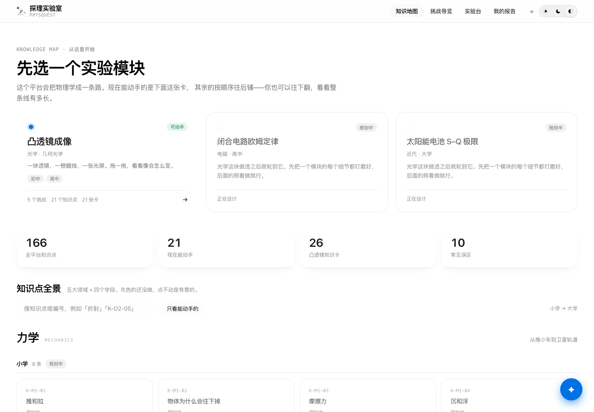
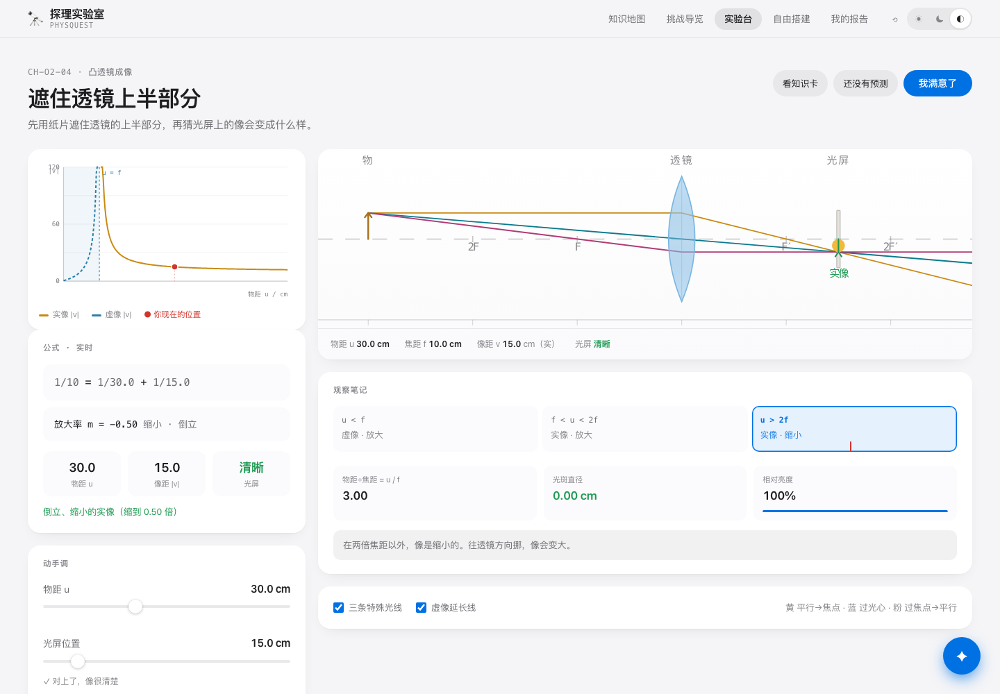

# PhysQuest · 探理实验室

[](https://github.com/NikiTheBear/PhysQuest/actions/workflows/preflight.yml)
[](https://github.com/NikiTheBear/PhysQuest/actions/workflows/deploy-pages.yml)
[](./LICENSE)

[中文](./README.md) · **English**

> **Live demo** → https://nikithebear.github.io/PhysQuest/
> (The online version is browser-only; the full interactive lab needs a local launcher — see "Run it" below.)

---

An open-source physics inquiry platform spanning primary school through university.

**Guess first. Then experiment. Get proven wrong. Then understand.**

Students drag a slider and watch the image on the screen grow and shrink. But before
they touch anything, they have to commit to a guess — and once they submit it, it locks.
Getting it wrong is the moment they remember.

This is not "AI writes you a beautiful physics report." It is **"place a bet, get
refuted, then work it out."**



---

## Why this exists

Most physics simulators work like this: drag a slider → watch an animation → close the tab.

The problem is **you forget it immediately**. No suspense, no bet, no moment of being
wrong means no memory.

So the core of this product isn't the ray diagram (accurate as it is) — it's **that
moment of getting it wrong**:

| | Your guess | What the engine computes |
|---|---|---|
| | Inverted, same size as the candle | **Inverted, reduced real image** |

That moment has nothing to do with AI. Offline, no API key, running from a USB stick —
it still works.

---

## Three counter-intuitive results

Every physics simulator should have moments that make you say "wait, what?". We built
three in the converging-lens module:

| Scenario | What students get wrong 100% of the time |
|---|---|
| **Cover the top half of the lens** | Expect half the image to disappear → actually **the image is complete, just dimmer** |
| **u = f** | Expect one enormous image → actually **no image at all**; rays exit parallel |
| **u < f** | Expect the screen to catch it → actually **it never can**, but your eye sees it fine |



---

## What's in it today

### Coverage

**176 knowledge points across six domains and four stages** (primary / junior / senior / university).

| Domain | Points | With a hands-on challenge | Notes |
|---|---|---|---|
| Mechanics | 41 | 24 | |
| Electromagnetism | 42 | 21 | |
| Optics | 32 | 21 | From shadows and magnifying glasses up to ABCD matrices |
| Acoustics | 15 | 15 | Full coverage |
| Thermodynamics | 26 | 0 | No thermodynamics solver yet — cards and quiz only |
| Modern physics | 20 | 0 | No quantum solver yet — cards and quiz only |

**Every knowledge point declares its model fidelity honestly**: 79 computable /
25 approximate / 72 conceptual-only. We never label a schematic as "computable".

### Learning flow

**Knowledge map → pick a module → challenge → guess (locked) → adjust → satisfaction
gate → question bank → report**

- ✅ **79 challenges** (optics 17 + mechanics 27 + circuits 21 + acoustics 14)
- ✅ **176 two-sided knowledge cards**. Each one carries:
  - *Front* — one-line conclusion / formula / everyday analogy / why it works /
    **deeper explanation** (2–3 paragraphs) / **don't confuse these** (common mix-ups) /
    **where you see it in life** / **test yourself** (three self-check questions)
  - *Back* — which instruments to use / how to arrange them / what to vary / what to
    observe / model boundaries / the full AI prompt
- ✅ **1,416 quiz questions** covering all 176 points, and **every question explains
  each option individually** — not just which one is right, but why each wrong one is wrong
- ✅ Students **choose which knowledge points to drill** instead of grinding from the top
- ✅ Exploration log: every locked-in parameter set is recorded
- ✅ Reports export to `.md`; **the reflection field must be written by the student — AI is
  not allowed to write it**

### The lab bench

- ✅ **Full-screen workbench**: 47 instruments across 7 domains (mechanics / acoustics /
  optics / electricity / magnetism / circuits / measurement), 24 AI tools
- ✅ Three ways in: from a challenge (with goal + prediction), from the top bar (blank
  bench), or from a knowledge card (AI builds it for you)
- ✅ Clear the bench, snapshot the moment, collapse the header
- ✅ 2D / 3D toggle, time scale 0.1×–4×, run / pause / step / reset
- ✅ Right-side AI chat (every edit is undoable) + instrument inspector
- ✅ Live readouts, signal plots, CSV export

### Physics

- ✅ Paraxial thin-lens model, `1/f = 1/u + 1/v` computed for real, locked by **12 assertions**
- ✅ Manual focusing: when the screen isn't at the image plane you get a **blurred disc**,
  not "no image"
- ✅ Circle of confusion and relative illuminance after masking are both computed
- ✅ The three principal rays are **real geometric constructions**, not illustrations
- ✅ Circuits use nodal analysis; RC/RL transients, series/parallel, power all work
- ✅ Acoustics is free-field spherical-wave superposition; two-source interference,
  directivity and distance falloff all work
- ✅ Rigid-body contact, friction and rotation run on Cannon
- ✅ **41 physics assertions in total** (optics 12 / mechanics 8 / circuits 11 / acoustics 10)

### Interface

- ✅ Apple-flavoured design; light / dark / follow-system
- ✅ Immersive full-screen bench with a collapsible header
- ✅ Built-in tutorial: what this is / the five places / the nine-step flow / three ways
  into the bench / do you need an API key / FAQ

### AI (BYOK — bring your own key)

- ✅ Students enter their own key in the browser. **Our servers never touch it.**
- ✅ Two connection modes: direct from the browser, or via the local launcher (bypasses CORS)
- ✅ The local launcher has **zero dependencies**; double-click on Node 18+
- ✅ The AI can only issue parameter commands, and only after the student clicks —
  **the AI has no privileges**
- ✅ Six provider presets: DeepSeek / Qwen / Kimi / Zhipu / OpenAI / custom
- ⬜ AI demo scripts and experiment grading

---

## Run it

### Just want to use it (with AI features)

```bash
cd apps/web && npm install && npm run build   # build once
cd ../launcher && node src/server.mjs         # start the launcher (zero deps)
```

Or double-click `apps/launcher/start.command` (macOS) / `start.bat` (Windows).

The browser opens `http://127.0.0.1:8787`. See [`docs/LAUNCHER.md`](./docs/LAUNCHER.md).

**Why a launcher?** Because of CORS: a web page generally can't call most LLM APIs
directly. This launcher listens on `127.0.0.1` only. It runs on your machine — **it is not
our server**.

The launcher also reverse-proxies the lab workbench (port 4317), so **one address is all
you need**:

```bash
node scripts/run-platform.mjs   # start the lab workbench (separate terminal)
```

### Development

```bash
cd apps/web
npm install
npm run dev        # → http://localhost:5180
npm test           # 41 physics assertions
```

### Validate content

```bash
node shared/knowledge-data/schema/validate.mjs   # content integrity
cd platform && npm test                          # 109 platform tests
```

### Regenerate content

```bash
node scripts/gen-knowledge-cards.mjs   # build 176 cards from the card text
node scripts/gen-challenges.mjs        # build challenges and experiment files
```

---

## Architecture (four sentences)

1. **Physics is computed by a local deterministic engine; the AI only explains.** Whatever
   the slider says, the rays follow.
2. **The lab is a pure parameter-driven renderer.** Hand it numbers, it draws a scene. No
   internal state.
3. **There is no server.** Learning records live in the browser, keys live in the browser.
   Zero backend = zero student-data risk.
4. **Content is data, not code.** 176 knowledge points, 176 cards and 1,416 questions all
   live in JSON. Editing text never means editing code.

```
Web layer (React: controls / state / routing)
    │  params
    ▼
Lab bench (Fieldlab: pure-JS solver + workbench UI)
    │  import
    ▲
Physics engine (pure functions, 41 assertions)
    ▲
    │  reads
Content layer (JSON under shared/knowledge-data/)
```

---

## Per-stage interaction

It's not a change of wording — it's a change of interaction depth:

| Stage | Points | Interaction |
|---|---|---|
| Primary | 29 | Visible phenomena only, **no formula symbols appear** |
| Junior | 59 | Optical bench + scale + manual focusing |
| Senior | 54 | Formula panel + curves + ray-construction grid |
| University | 34 | Model boundaries, approximation conditions, matrix methods |

---

## Docs

| File | Contents |
|---|---|
| [`PLAN.md`](./PLAN.md) | Full plan: architecture, knowledge system, roadmap, acceptance criteria |
| [`docs/STUDENT-FLOW.md`](./docs/STUDENT-FLOW.md) | **The nine steps from opening the page to exporting a report** |
| [`docs/LAUNCHER.md`](./docs/LAUNCHER.md) | The local launcher: why it exists, how to use it, two ways to set a key |
| [`docs/BRIEF-FOR-B.md`](./docs/BRIEF-FOR-B.md) | Spec sheet for the lab lead |
| [`docs/HANDOFF-FOR-C.md`](./docs/HANDOFF-FOR-C.md) | Fill-in-the-blank guide for the content lead |
| [`CONTRIBUTING.md`](./CONTRIBUTING.md) | Contribution guide: who owns which files, how to submit, five hard rules |

---

## Roadmap

| | Content | Status |
|---|---|---|
| M1 | Physics engine + dual-pane bench | ✅ |
| M2 | Complete learning loop (hub → cards → predict → experiment → quiz → report) | ✅ |
| M2.5 | Fieldlab merged in + 166 knowledge cards | ✅ |
| M2.6 | Selectable quiz topics + 1,416 questions with per-option explanations + thicker cards + acoustics as its own domain | ✅ |
| M2.7 | Optics expanded into a full domain (all 32 points have challenges) + all 176 card backs filled in | ✅ |
| M3 | AI: tutor / launcher ✅ / demo scripts ⬜ / experiment grading ⬜ | 🚧 |
| M3.5 | Formula lab for the 97 "approximate / conceptual-only" points | ⬜ |
| M3.6 | Thermodynamics and modern physics (46 points): honestly explain why they are read-only | ⬜ |
| M4 | Open-source release + offline single-file build | 🚧 |
| M5 | More instruments (reflective surfaces, pinholes, an eye model…) | ⬜ |

---

## One hard rule

**We will never write a single line of server-side code that can receive a student's API key.**

- Keys live only in the student's own browser
- The local launcher listens on `127.0.0.1` only; no logging, no persistence
- Any "official proxy endpoint" in the code counts as a bug

---

## People

| | GitHub | What they built |
|---|---|---|
| **A** | [@NikiTheBear](https://github.com/NikiTheBear) | Web app (5 pages / 23 components / 16,353 lines), physics engine, **all 176 knowledge cards**, **1,416 quiz questions**, **176 AI prompts**, AI integration, local launcher, CI & deployment, bilingual docs |
| **B** | [@FCZ19](https://github.com/FCZ19) | Fieldlab platform (8,254 lines): physics solvers, **47 instruments**, **25 MCP tools**, full-screen workbench, 109 tests |
| **C** | [@yoyosiqidai-cpu](https://github.com/yoyosiqidai-cpu) | Formula lab (97 entries), misconception bank, experiment files, handwritten questions, teacher handbook, delivery tests |

Read the [contribution guide](./CONTRIBUTING.md) before you start.

---

## License

[MIT](./LICENSE)
