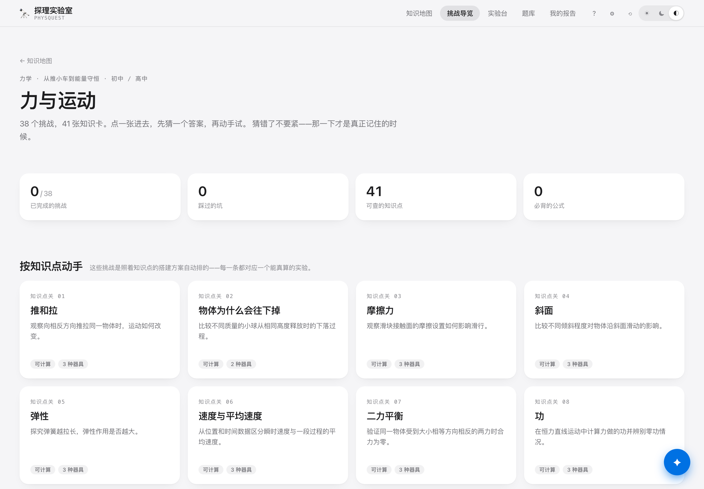
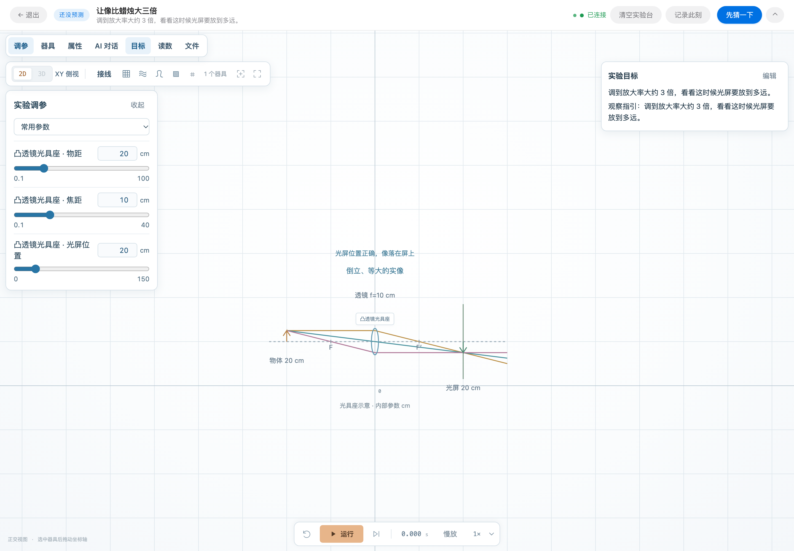
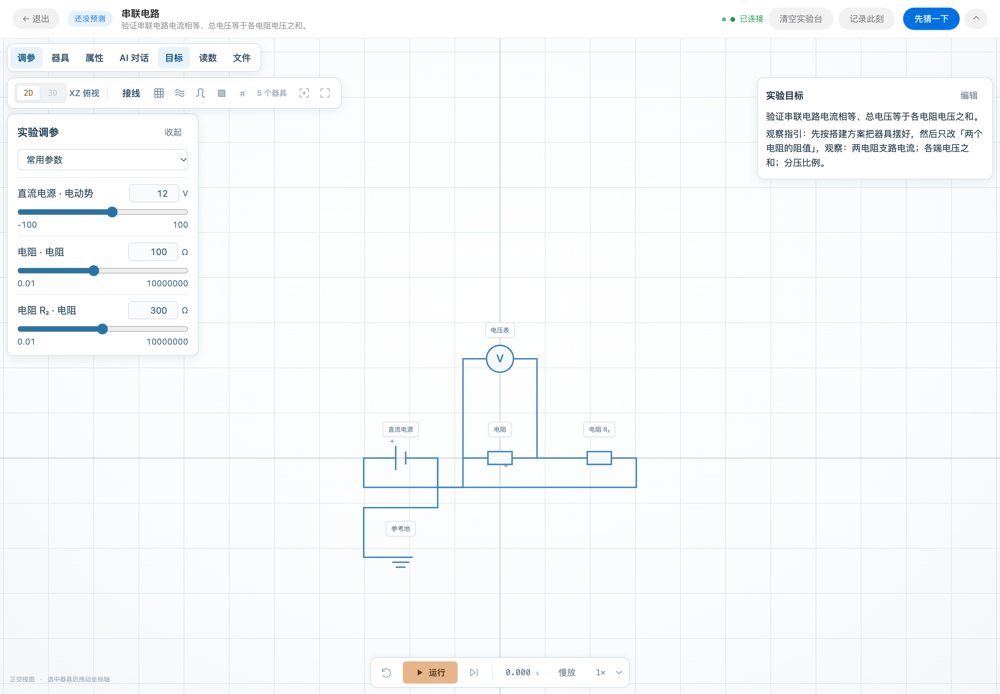
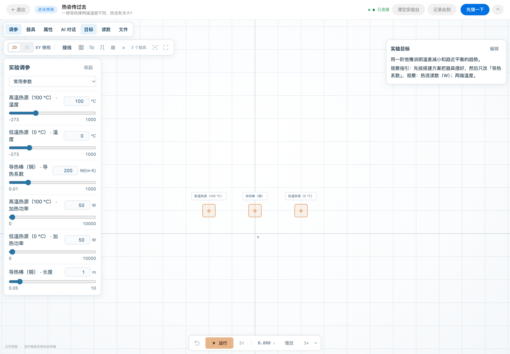
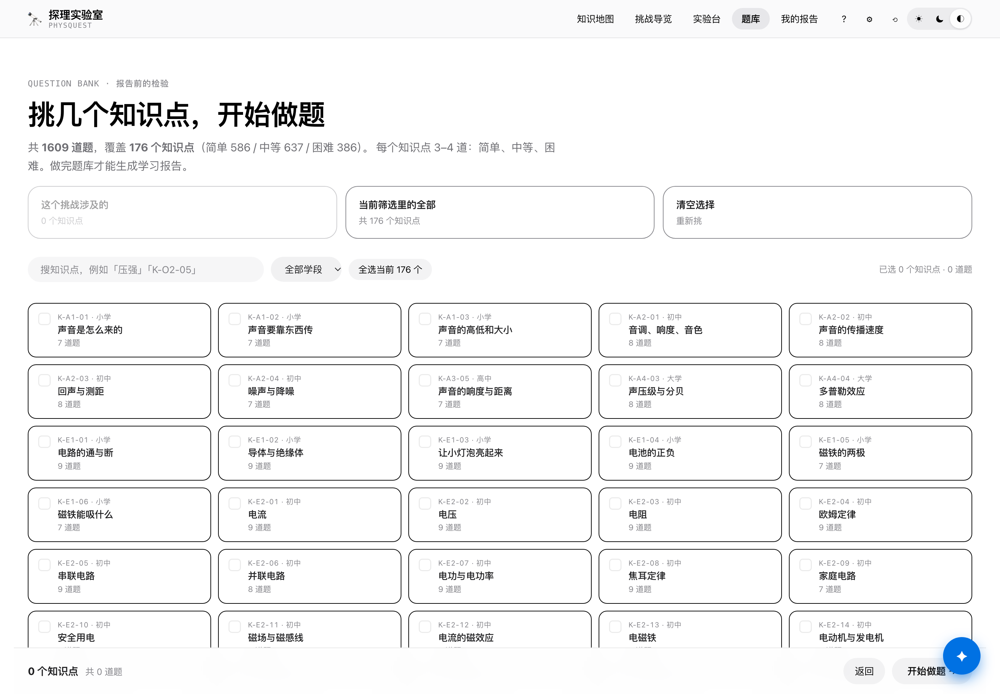
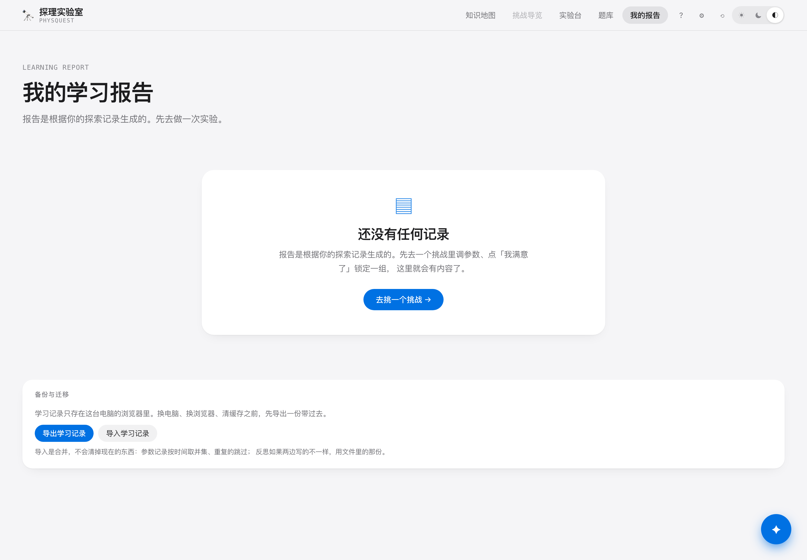

# 探理实验室 · PhysQuest

[](https://github.com/Wave-to-Say-HI/PhysQuest/actions/workflows/preflight.yml)
[](./LICENSE)

[English](./README.en.md) · **在线版** → https://wave-to-say-hi.github.io/PhysQuest/

---

一个开源的物理探究平台。176 个知识点，从小学到大学。

核心设计只有一条：**先猜，再做，被推翻，然后想明白。**

学生动滑块之前得先写下一个答案，写完就锁死。猜错的那一下，他记得住。
这一步跟 AI 完全无关——断网、没配 Key、U 盘拷走，照样能用。


---

## 五个模块

| 模块 | 知识点 | 挑战 | 器具 |
|---|---|---|---|
| 光学 | 32 | 22 | 光具座、激光、透镜、平面镜、光阑、滤光片、折射界面、针孔装置、眼球模型 |
| 力与运动 | 41 | 38 | 刚体、弹簧、斜面、绳索、连杆、阻尼器、各种力源、测力计、滚轮、流体阻力 |
| 电路与电流 | 42 | 33 | 电源、电阻、电容、电感、开关、灯泡、电压表、电流表、变阻器、交流源、恒流源 |
| 声与波 | 15 | 14 | 点声源、指向性声源、测量麦克风 |
| 热学 | 26 | 26 | 温度计、恒温热源、导热棒 |

一共 53 种器具。物理全在本地算——刚体用 Cannon，电路用节点电压法，光学是近轴薄透镜，声学是球面波叠加，热学是傅里叶导热。



**176 个知识点里 135 个能动手做实验。** 剩下 41 条（近代 20 条 + 缺器具的 21 条）点进去是空实验台，顶栏写着「这一条平台做不出实验：……」——我们不把示意图说成能算。

---

## 一次完整的学习

1. **知识地图** —— 选模块，或者直接翻知识点卡片
2. **挑战导览** —— 一个模块拆成几十个小挑战，每个只问一件事
3. **先猜** —— 一句话、一个输入框，猜完锁死
4. **进实验台** —— 拖滑块、挪光屏、接线路，看着读数实时变
5. **我满意了** —— 打星，写一句为什么选这组参数
6. **锁定这组参数** —— 记进探索记录。不强制做题，想去才去
7. **题库** —— 自己挑知识点，每个从简单做到困难，答错给逐项解析
8. **写反思** —— 至少 10 个字，AI 不能代写
9. **生成报告** —— 导出 .md







---

## 题库和报告

1609 道题，176 个知识点全覆盖。每题两套解析：一套说正确答案为什么对，一套逐项说清每个错项错在哪。

选项顺序按题 id 稳定打乱——派生题的正确答案原来永远在 A，学生做三道就发现规律了。



报告有两道闸门：题库做完一遍 + 反思至少 10 个字。都是故意的——报告是学习的收尾，不是点一下就能生成的装饰品。



---

## 还有什么

**公式实验室** —— 97 条「近似 / 仅示意」的知识点配了试算器，学生自己填参数看公式算出什么。取值器是自写的 tokenizer + 递归下降解析，没把字符串交给 JS 引擎。

**AI 实验评分** —— 四个维度：组装 30% / 观测 30% / 变量控制 25% / 结论 15%。前三个由本地代码算死，AI 只在「结论」上做语义核对并写评语。它的输出结构里没有 `score` 字段——让 AI 打分它就会自己算物理。没配 Key 也能用，只显示本地三维度。

**学习记录导出 / 导入** —— 存在浏览器里，能导出成 JSON 带走，导入时按时间取并集。

---

## 跑起来

### 只想用

```bash
cd apps/web && npm install && npm run build
cd ../launcher && node src/server.mjs
```

或者双击 `apps/launcher/start.command`。浏览器会打开 `http://127.0.0.1:8787`。

实验台是另一个服务，另开一个终端：

```bash
node scripts/run-platform.mjs
```

启动器会把实验台反向代理到同一个地址。详见 [`docs/LAUNCHER.md`](./docs/LAUNCHER.md)。

**为什么要有启动器？** 浏览器的跨域限制不让网页直接调大模型接口。它只监听 `127.0.0.1`，跑在你自己电脑上——不是我们的服务器。

### 开发

```bash
cd apps/web
npm run dev        # → http://localhost:5180
npm test           # 310 条前端测试
```

### 校验

```bash
node shared/knowledge-data/schema/validate.mjs   # 内容完整性
cd platform && npm test                          # 168 条平台测试
```

**一个坑**：跑平台测试之前必须先同步快照，否则会读 gitignore 里的旧数据报假错：

```bash
cd platform && node scripts/sync-physquest.mjs && node scripts/gen-test-assets.mjs && npm test
```

---

## 架构

四句话：

1. **物理由本地引擎算，AI 只解释。** 滑块拖到哪，结果就是哪。
2. **实验室是纯参数驱动的渲染器。** 给一组数字，画一张图，没有内部状态。
3. **没有服务器。** 学习记录存浏览器，密钥存浏览器，零后端 = 零学生数据风险。
4. **内容是数据，不是代码。** 176 条知识点、176 张卡、1609 道题全是 JSON。

```
网页层（React）
    │  params
    ▼
实验台（Fieldlab：纯 JS 求解器 + 工作台）
    │  import
    ▲
物理引擎（纯函数，52 条断言）
    ▲
    │  读取
内容层（shared/knowledge-data/ 的 JSON）
```

### 分学段 = 换交互深度

| 学段 | 知识点 | 交互 |
|---|---|---|
| 小学 | 29 | 看得见的现象，不出现公式符号 |
| 初中 | 59 | 光具座、刻度、手动对焦 |
| 高中 | 54 | 公式面板、曲线、作图网格 |
| 大学 | 34 | 模型边界、近似条件、矩阵方法 |

同一个「凸透镜成像」，小学只讲「放大镜能把字放大」，初中要调光具座找清晰位置，高中要验证 1/f = 1/u + 1/v，大学要讨论球差和近轴近似的失效。

---

## 分工

| | GitHub | 主要做了什么 | 占比 |
|---|---|---|---|
| **A** | [@NikiTheBear](https://github.com/NikiTheBear) | 网页主体（五个页面 / 23 个组件 / 29,554 行）、物理引擎、176 张知识卡文案、1609 道题、176 条 AI 提示词、本地启动器、CI 部署、中英文档 | 40% |
| **B** | [@FCZ19](https://github.com/FCZ19) | Fieldlab 平台（17,502 行）：物理求解器、器具库、MCP 工具、全屏工作台、133 条测试 | 34% |
| **C** | [@yoyosiqidai-cpu](https://github.com/yoyosiqidai-cpu) | 97 条公式实验室定义、46 条误区库、190 道手写题、30+ 个手写实验、UI 打磨、老师手册 4 篇 | 26% |

### 一个文件只有一个主人

| 范围 | 主人 |
|---|---|
| `apps/web/src/**`、`scripts/**`、`apps/launcher/**`、`.github/**` | A |
| `platform/**`（求解器、工作台、器具库、MCP 工具、测试） | B |
| `shared/knowledge-data/card-text/**`、`card-detail/**`、`question-bank.ts` | A |
| `platform/experiments/*.pqexp.json`、`docs/handbook/**` | C |

---

## 路线图

| | 内容 | 状态 |
|---|---|---|
| M1 | 物理引擎 + 双屏实验台 | ✅ |
| M2 | 完整学习闭环 | ✅ |
| M2.5 | Fieldlab 并入 + 166 张知识卡 | ✅ |
| M2.6 | 题库可选知识点 + 逐项解析 | ✅ |
| M2.7 | 光学扩成完整领域 | ✅ |
| M3.1 | 公式实验室（97 条） | ✅ |
| M3.2 | AI 实验评分 | ✅ |
| M3.3 | 学习记录导出 / 导入 | ✅ |
| M3.4 | 热学成为第五个模块 | ✅ |
| M4 | 近代 20 条的量子示意器具 | ⬜ |
| M5 | 离线单文件版 | ⬜ |
| M6 | 按教材重新规划知识点体系 | 🚧 |

---

## 一条硬红线

**我们永远不会写一行能接收学生 API Key 的服务端代码。**

密钥只存在学生自己的浏览器里；本地启动器只监听 `127.0.0.1`，不写日志、不落盘。

---

## 文档

| 文件 | 内容 |
|---|---|
| [`docs/STUDENT-FLOW.md`](./docs/STUDENT-FLOW.md) | 学生从打开网页到导出报告的九步 |
| [`docs/LAUNCHER.md`](./docs/LAUNCHER.md) | 本地启动器：为什么需要、怎么用 |
| [`docs/DELIVERY-TEST.md`](./docs/DELIVERY-TEST.md) | 交付测试清单：10 类场景 |
| [`docs/handbook/`](./docs/handbook/) | 老师手册：五分钟上手 / 一节课怎么安排 / 常见问题 / 接 AI |
| [`platform/experiments/FORMAT.md`](./platform/experiments/FORMAT.md) | 实验文件格式 |

---

## 授权

[MIT](./LICENSE)
