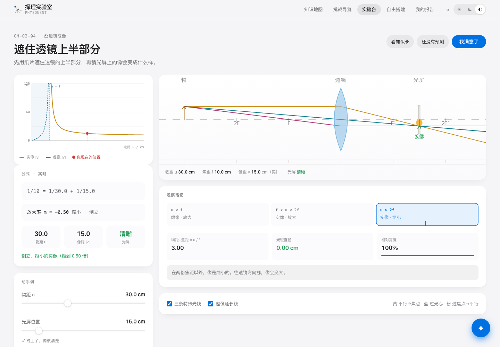

# 探理实验室 · PhysQuest

[](https://github.com/Wave-to-Say-HI/PhysQuest/actions/workflows/preflight.yml)
[](https://github.com/Wave-to-Say-HI/PhysQuest/actions/workflows/deploy-pages.yml)
[](./LICENSE)

**English** · [README.en.md](./README.en.md)

> **在线试玩** → https://nikithebear.github.io/PhysQuest/
> （在线版只有直连模式，实验台需要本地启动器，见下面的「跑起来」）

---

一个开源的全学段物理探究平台。

**先猜，再做，被推翻，然后想明白。**

学生拖动滑块，看着光屏上的像变大变小。但在动手之前他得先猜，猜完就被锁死；
猜错的那一下，他记一辈子。

这不是「AI 生成一份漂亮的物理报告」，是**「先押注、被推翻、再想明白」**。


---

## 为什么做这个

市面上大多数物理模拟器是这样：拖滑块 → 看动画 → 关掉。

问题在于**看完就忘**。没有悬念、没有押注、没有被打脸，就没有记忆。

所以这个产品的核心不是那张光路图（虽然它确实很准），而是**猜错的那一下**：

| | 你的猜测 | 物理引擎算出的 |
|---|---|---|
| | 倒立、和蜡烛一样大 | **倒立、缩小的实像** |

这一下跟 AI 完全无关。断网、没配 Key、离线用 U 盘，这一下照样工作。

---

## 三个反直觉现象

每个物理模拟器都应该有让人「咦？」的时刻。凸透镜这块我们做了三个：

| 现象 | 学生 100% 会猜错的地方 |
|---|---|
| **遮住透镜上半** | 以为像会只剩一半 → 实际**像完整，只是变暗** |
| **u = f** | 以为会成一个巨大的像 → 实际**不成像**，出射光平行 |
| **u < f** | 以为光屏上能接住 → 实际**永远接不住**，但眼睛能看到 |



---

## 现在能做什么

### 知识点覆盖：135 / 176 有能动手的实验

| 领域 | 知识点 | 有挑战 | 代表内容 |
|---|---|---|---|
| 力学 | 41 | **35** | 从推小车到粘滞流体 |
| 电磁 | 42 | **33** | 从电路通断到自感、电动机 |
| 光学 | 32 | **26** | 从针孔成像到 ABCD 矩阵 |
| 声学 | 15 | **15** | 全覆盖 |
| 热学 | 26 | **26** | 9 条真实验 + 17 条边界说明 |
| 近代 | 20 | 0 | 平台没有量子求解器，只有卡片和题 |

**每条知识点的模型级别都是老实标注的**：可计算 / 近似 / 仅示意。
我们没有把「仅是示意图」说成「可以算」。

### 学习流程

**知识地图 → 选模块 → 挑战 → 先猜（锁死）→ 调参 → 满意度闸门 → 题库 → 报告**

- ✅ **133 个挑战**（光学 17 + 力学 38 + 电路 33 + 声学 14 + 热学 26 + 手写 5）
- ✅ **176 张双面知识卡**，每张都有：
  正面 —— 一句话结论 / 公式 / 打个比方 / 为什么 / **讲透一点**（2–3 段）/ **别搞混** / **生活里在哪见** / **自己考自己**
  背面 —— 用哪些器具 / 怎么摆 / 调什么 / 看什么 / 模型边界 / 完整 AI 提示词
- ✅ **1609 道题**，176 个知识点全覆盖，**每题都有总解析 + 逐项解析**（每个选项错在哪都写清）
- ✅ 题库可选：学生**自己挑要做哪些知识点**，不用从头刷到尾
- ✅ 做完实验**不强制做题**，只弹一条建议（想去才去）
- ✅ 探索记录对任何模块都通用（电学记电流电压，热学记温度热流）
- ✅ 报告导出 `.md`，**反思必须手写，AI 不代写**

### 实验台

- ✅ **全屏工作台**：53 种器具、8 个领域（力/声/光/电/磁/电路/测量/热学）、25 个 AI 工具
- ✅ 三种进法：从挑战进（带目标 + 先猜）/ 从顶栏进（空白台）/ 从知识卡进（AI 帮搭）
- ✅ 清空实验台、记录此刻、收起顶栏
- ✅ 2D / 3D 切换、时间倍率 0.05×–4×、运行 / 暂停 / 单步 / 重置
- ✅ 右侧 AI 对话（每次修改都能撤销）+ 器具属性面板
- ✅ 实时读数、信号曲线、CSV 导出

### 公式实验室

**97 条「近似 / 仅示意」的知识点可以交互了。**

学生自己填参数，看公式算出什么。取值器是自己写的 tokenizer + 递归下降解析（三道白名单闸门，不把字符串交给 JS 引擎），不依赖 `eval`。

### AI 实验评分

四个维度：**组装 30% / 观测 30% / 变量控制 25% / 结论 15%**。

**前三个由本地代码算死，AI 只在「结论」上做语义核对并写评语。** AI 的输出里没有 `score` 字段——让 AI 打分它就会自己算物理。

没配 API Key 也能用：只显示本地三维度，D4 提示「需要配置 AI」。

### 物理

- ✅ 薄透镜近轴模型，`1/f = 1/u + 1/v` 全部真算，**12 条断言锁死**
- ✅ 手动对焦：光屏不在像的位置时是**模糊光斑**，不是「没像」
- ✅ 弥散圆、遮光后的相对亮度，都是算出来的
- ✅ 电路用节点电压法，RC / RL 暂态、串并联、电功率都能算
- ✅ 声学是自由场球面波叠加，双源干涉、指向性、距离衰减都能算
- ✅ 刚体接触、摩擦、转动用 Cannon（**注意 `frictionGravity`，否则摩擦恒为 0**）
- ✅ 热学：一阶滞后温度计、恒温热源、傅里叶导热棒
- ✅ 光学新器具：折射界面（斯涅尔 + 全反射）、针孔成像装置、眼球模型
- ✅ **52 条物理断言 + 168 条平台测试**

### 界面

- ✅ Apple 风格，日间 / 夜间 / 跟随系统三档
- ✅ 全屏沉浸式实验台，顶栏可收起
- ✅ 教程页：这是什么 / 五个地方 / 九步流程 / 实验台三种进法 / 要不要配 Key / 常见问题

### AI（BYOK，自带密钥）

- ✅ 学生在网页里填自己的 Key，**我们的服务器永远不碰**
- ✅ 双连接方式：浏览器直连 / 本地启动器（绕开跨域）
- ✅ 本地启动器**零依赖**，Node 22+ 双击即用
- ✅ AI 只能下发参数指令，学生点了才动 —— **AI 没有任何特权**
- ✅ 六家厂商预设：DeepSeek / 通义千问 / Kimi / 智谱 / OpenAI / 自定义

---

## 跑起来

### 只想用（含 AI 功能）

```bash
cd apps/web && npm install && npm run build   # 先构建一次
cd ../launcher && node src/server.mjs         # 起启动器（零依赖）
```

或者直接双击 `apps/launcher/start.command`（macOS）/ `start.bat`（Windows）。

浏览器会打开 `http://127.0.0.1:8787`。详见 [`docs/LAUNCHER.md`](./docs/LAUNCHER.md)。

**为什么需要启动器？** 因为浏览器的跨域限制不允许网页直接调大部分大模型接口。
这个启动器只监听 `127.0.0.1`，跑在你自己的电脑上，**不是我们的服务器**。

启动器还会把实验台工作台（4317 端口）反向代理进来，所以**你只需要开一个地址**：

```bash
node scripts/run-platform.mjs   # 起实验台工作台（另开一个终端）
```

`run-platform.mjs` 会**自动判断要不要重建 dist**（源码比 dist 新就重建），所以改完代码不用手动 build。

### 开发

```bash
cd apps/web
npm install
npm run dev        # → http://localhost:5180
npm test           # 310 条前端测试
```

### 校验

```bash
node shared/knowledge-data/schema/validate.mjs   # 内容完整性
cd platform && npm test                          # 168 条平台测试
```

### 重新生成内容

```bash
node scripts/gen-knowledge-cards.mjs   # 从卡片文字生成 176 张知识卡
node scripts/gen-challenges.mjs        # 从提示词生成挑战和实验文件
node scripts/handwritten-labs.mjs      # 手写实验（热学等）
```

---

## 架构（四句话）

1. **物理由本地确定性引擎计算，AI 只解释不算数。** 滑块拖到哪，光路就是哪。
2. **实验室是纯参数驱动的渲染器。** 给它一组数字，它画一张图，没有内部状态。
3. **没有服务器。** 学习记录存浏览器，密钥存浏览器，零后端 = 零学生数据风险。
4. **内容是数据，不是代码。** 176 条知识点、176 张卡、1609 道题都在 JSON 里，改文字不用改程序。

```
网页层（React：控件 / 状态 / 路由）
    │  params
    ▼
实验台（Fieldlab：纯 JS 求解器 + 工作台 UI）
    │  import
    ▲
物理引擎（纯函数，52 条断言）
    ▲
    │  读取
内容层（shared/knowledge-data/ 下的 JSON）
```

### 分学段 = 换交互深度

| 学段 | 知识点数 | 交互 |
|---|---|---|
| 小学 | 29 | 看得见的现象，**不出现公式符号** |
| 初中 | 59 | 光具座 + 刻度 + 手动对焦 |
| 高中 | 54 | 公式面板 + 曲线 + 作图网格 |
| 大学 | 34 | 模型边界、近似条件、矩阵方法 |

---

## 分工

三个人一起做，A 写网页和内容，B 写实验台平台，C 写实验和补充内容。

| | GitHub | 负责范围 | 已完成 |
|---|---|---|---|
| **A** | [@NikiTheBear](https://github.com/NikiTheBear) | 网页主体、物理引擎、知识卡文案、题库、AI 接入、启动器、部署、文档 | 5 个页面 / 23 个组件 / 29,554 行；**176 张知识卡**；**1609 道题**；**176 条 AI 提示词**；52 条物理断言 |
| **B** | [@FCZ19](https://github.com/FCZ19) | Fieldlab 平台：物理求解器、器具库、MCP 工具、全屏工作台 | 17,502 行；**47 种器具**（光学 7 / 力学 15 / 电路 12 / 测量 5 / 电学 3 / 磁学 3 / 声学 2）；**25 个 MCP 工具**；133 条测试 |
| **C** | [@yoyosiqidai-cpu](https://github.com/yoyosiqidai-cpu) | 实验文件、内容补充、UI 打磨、交付测试 | **97 条公式实验室定义**；**46 条误区库**；**190 道手写题**；30+ 个手写实验；老师手册 4 篇；交付测试清单 |

> A 后来又补了 6 种器具（热学 3 + 光学 3），所以现在是 53 种。

### 一个文件只有一个主人

| 范围 | 主人 |
|---|---|
| `apps/web/src/**`、`scripts/**`、`apps/launcher/**`、`.github/**` | **A** |
| `platform/**`（求解器、工作台、器具库、MCP 工具、测试） | **B** |
| `shared/knowledge-data/card-text/**`、`card-detail/**`、`question-bank.ts` | **A** |
| `platform/experiments/*.pqexp.json`（实验数据）、`docs/handbook/**` | **C** |

详细的贡献规则见 [`CONTRIBUTING.md`](./CONTRIBUTING.md)。

---

## 路线图

| | 内容 | 状态 |
|---|---|---|
| M1 | 物理引擎 + 双屏实验台 | ✅ |
| M2 | 完整学习闭环（导览→卡片→预测→实验→测验→报告） | ✅ |
| M2.5 | Fieldlab 并入 + 166 张知识卡 | ✅ |
| M2.6 | 题库可选知识点 + 逐项解析 + 知识卡加厚 + 声学独立 | ✅ |
| M2.7 | 光学扩成完整领域 + 176 张卡背面 100% 补全 | ✅ |
| M3.1 | 公式实验室（97 条） | ✅ |
| M3.2 | AI 实验评分（本地三维度 + AI 评语） | ✅ |
| M3.3 | 学习记录导出 / 导入 | ✅ |
| M3.4 | 热学成为第五个模块（26 关卡） | ✅ |
| M3.5 | 演示剧本播放器 | ✅ |
| M4 | 近代 20 条的量子示意器具 | ⬜ |
| M5 | 离线单文件版 | ⬜ |

---

## 一条硬红线

**我们永远不会写一行能接收学生 API Key 的服务端代码。**

- 密钥只存在学生自己的浏览器里
- 本地启动器只监听 `127.0.0.1`，不写日志、不落盘
- 代码里任何「官方中转地址」都算 bug

---

## 文档

| 文件 | 内容 |
|---|---|
| [`PLAN.md`](./PLAN.md) | 原始项目计划书（2026-11-18，含当时的团队分工与路线图，**部分内容已过时**） |
| [`CONTRIBUTING.md`](./CONTRIBUTING.md) | 贡献指南：文件归属、提交规则、五条硬规矩 |
| [`docs/STUDENT-FLOW.md`](./docs/STUDENT-FLOW.md) | 学生从打开网页到导出报告的九步 |
| [`docs/LAUNCHER.md`](./docs/LAUNCHER.md) | 本地启动器：为什么需要、怎么用、两种配 Key 方式 |
| [`docs/DELIVERY-TEST.md`](./docs/DELIVERY-TEST.md) | 交付测试清单：10 类场景 |
| [`docs/handbook/`](./docs/handbook/) | 老师手册（4 篇：五分钟上手 / 一节课怎么安排 / 常见问题 / 接 AI） |
| [`platform/experiments/FORMAT.md`](./platform/experiments/FORMAT.md) | 实验文件格式（`.pqexp.json`） |

---

## 授权

[MIT](./LICENSE)
