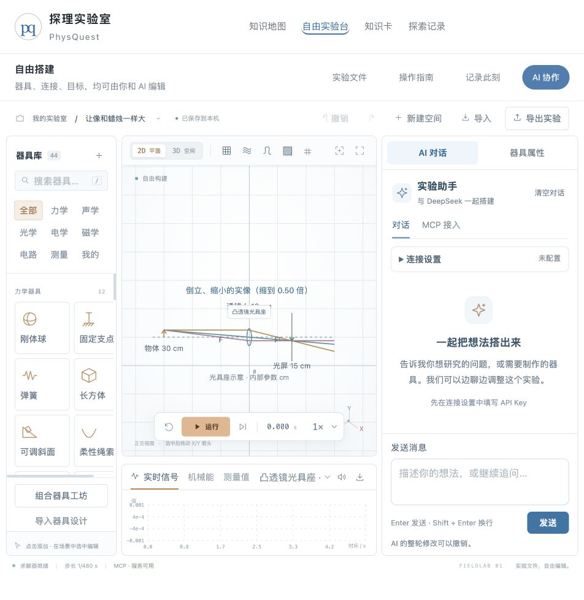

# PhysQuest · 自由搭建物理实验室

保留 PhysQuest 知识地图与知识卡，将实验台升级为 Fieldlab 自由仿真平台。人和 AI 可以编辑同一份实验文档、制作器具、连接不同物理过程，并调用数值求解器验证。



## 启动完整平台

需要 **Node.js 22 或更新版本**。克隆本分支后，在仓库根目录运行：

```sh
node scripts/run-platform.mjs
```

macOS 也可双击根目录 `start.command`。首次启动自动安装依赖并构建，随后打开终端显示的地址（默认 `http://127.0.0.1:4317/`）。全部平台源代码已包含在 `platform/`，不再需要同级目录。

开发时也可手动运行：

```sh
cd platform
npm run sync:physquest
npm run install:ci
npm run build
npm run dev
```

`apps/web/` 是 PhysQuest 外壳的主源码，`platform/physquest/` 是构建时使用的快照；修改外壳后先执行同步命令。实验文档存于本机 `platform/.local/`，不会进入 Git。

## 功能

- 白色工作台，2D / 3D 切换；点击器具显示坐标轴，可拖动、吸附、复制、撤销与重做。
- 44 类器具，覆盖力学、声、光、电、磁、电路和测量；支持可复用的单件与组合器具。
- 滑块拖动实时渲染；碰撞范围可显示、编辑，运行时参与实际机械阻挡。
- 原版 5 个实验以 `.pqexp.json` 保存，首次自动载入，之后恢复已有编辑；新建空间为空白。
- 140 个规划知识点的可编辑提示词：49 个可直接计算、22 个近似或类比、69 个概念示意。完整说明见 [提示词文档](platform/prompts/README.md)。
- 右侧聊天栏内置 DeepSeek，通过与 MCP 共用的 23 个工具搭建实验、制作器具、修改参数与模式。消息失败时保留草稿，AI 一轮操作可整体撤销。
- JSON 实验文件与器具设计导入/导出，CSV 采样导出，探索记录与观察笔记。

## DeepSeek 与 MCP

在实验台右侧的「AI 对话 → 连接设置」填写自己的 DeepSeek API Key。密钥仅保留当前页面会话，不写入实验文件或仓库；请求经过本地服务或已配置鉴权的 Worker 转发到 DeepSeek 官方 API，费用由相应账户承担。AI 的工作区操作经过与网页相同的参数校验，整轮成功后才提交。

本地 MCP 端点为 `http://127.0.0.1:4317/mcp`。完整工具和物理模型范围见 [平台说明](platform/README.md)。本地开发服务使用固定开发身份，仅监听回环地址；在线部署需要单独配置身份认证与 `BUCKET` 存储。

## GitHub Pages 与离线版

Pages 使用自包含的静态工作台，支持仿真、器具编辑和浏览器本地保存。**静态托管没有 DeepSeek 代理或远程 MCP 服务**；需要 AI 时运行完整平台。

```sh
cd platform
VITE_BASE=/PhysQuest/ npm run build:pages
```

Pages 产物位于 `platform/dist/pages/`；构建也会生成单文件 `platform/standalone/fieldlab.html`，可离线打开。GitHub Actions 在 `main` 部署 Pages，在功能分支和 PR 中执行检查。

## 验证

```sh
bash scripts/preflight.sh
cd platform
npm run build
npm test
npm run validate
```

原版光学引擎 12 项断言与平台 87 项物理、实验文件、MCP、DeepSeek 模拟上游测试。真实付费模型调用不属于自动化测试。

## 许可与来源

基于 [NikiTheBear/PhysQuest](https://github.com/NikiTheBear/PhysQuest)，保留 [MIT 许可](LICENSE)、原版知识数据和光学引擎。原始项目介绍存于 [上游 README](docs/README-UPSTREAM.md)，自由探索版变更见 [FREE-BUILD.md](FREE-BUILD.md)。
